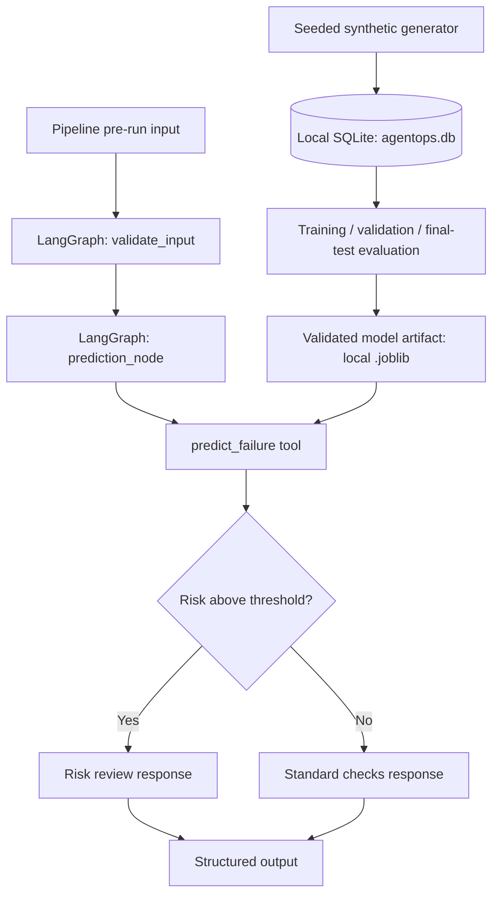
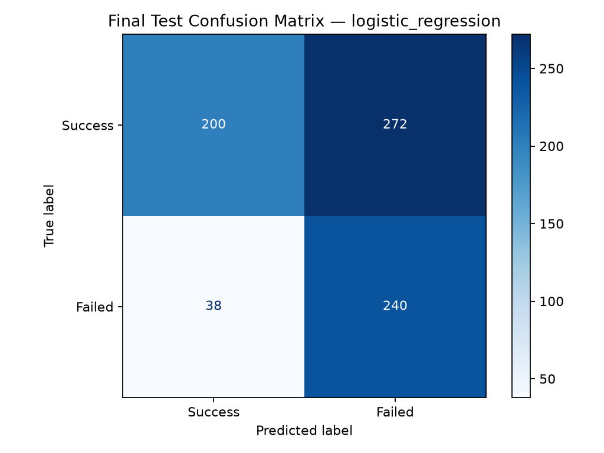
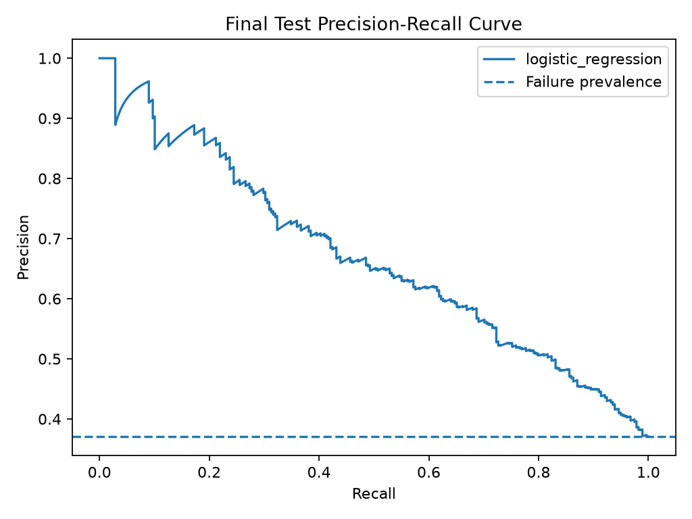
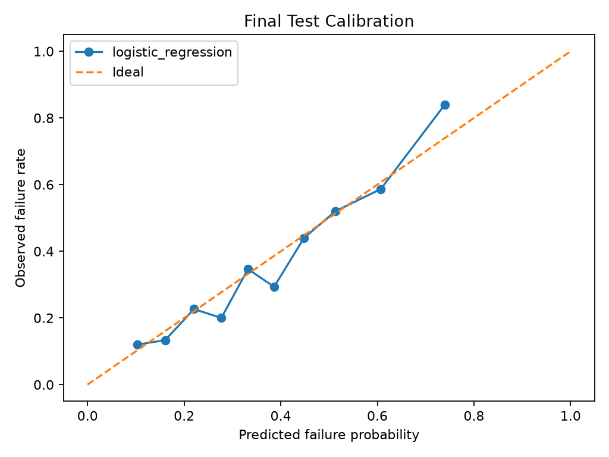

# AgentOps Intelligence Lab

**A reproducible, evaluation-first prototype for predicting data-pipeline failures and building toward evidence-grounded AI incident investigation.**

**Current status:** Synthetic data pipeline, baseline predictive ML, validated evaluation workflow, inference tool, and deterministic LangGraph risk-routing workflow implemented. **Planned:** SQL investigation tools, historical incident retrieval/RAG, LLM-assisted investigation, agent evaluations, OpenTelemetry, API deployment, containerization, and CI/CD.

> **Scope and safety:** This is a portfolio/research prototype using synthetic data. Its risk probabilities and recommendations are **not validated for production decisions**. It does not currently take autonomous remediation actions.

## 1. Mission and problem

Production data platforms run ingestion, ETL, synchronization, and reporting jobs. Failures may stem from resource pressure, workload, or transient processing issues. Teams need not only alerts but also reproducible risk estimates, relevant evidence, and explanations that can be tested.

**Mission:** Build an end-to-end system that evolves from **data generation → failure-risk prediction → tool-based investigation → stateful agent orchestration → rigorous evaluations → observable deployment**.

**Questions this project explores:**
- Can pre-execution signals estimate failure risk without leaking information from after a run?
- How should a prediction service be wrapped as a safe, reusable tool?
- How can a graph direct high-risk cases to further review while preserving traceable state?
- How do we evaluate predictive models *and* agent behavior separately?

## 2. What is implemented today

| Layer | Implementation | Status |
|---|---|---|
| Data | Reproducible Python generators and local SQLite tables | Implemented |
| Synthetic scenarios | 5,000 `realistic_incidents` rows with simulated pre-run conditions and simplified root-cause labels | Implemented |
| Predictive ML | Majority-class baseline, Logistic Regression, Random Forest | Implemented |
| Evaluation | Chronological 70/15/15 split; select model on validation average precision; tune threshold on validation F1; final test metrics and figures | Implemented |
| Inference | `predict_failure()` validates inputs, loads the local trusted model artifact, returns structured risk output | Implemented |
| Workflow | LangGraph shared state, validation and prediction nodes, conditional high/low-risk routes | Implemented (deterministic) |
| Agent reasoning, RAG, external telemetry, deployment | Not yet implemented | Roadmap |

**Terminology:** The current LangGraph system is a deterministic tool-using workflow, **not** an autonomous LLM agent. The SQL investigative agent, retrieval, LLM-driven decisions, and guarded remediation are future milestones.

## 3. Architecture



In the workflow, **state** carries the input, prediction and route; **nodes** do bounded work; **edges** define execution order; the **conditional edge** selects a route. The ML model performs inference—it does not orchestrate the graph.

For the current graph definition, see [the LangGraph workflow diagram](docs/langgraph_workflow.md). For planned architecture and evaluation decisions, see [architecture](docs/architecture.md), [evaluation methodology](docs/evaluation_methodology.md), and the [model card](docs/model_card.md).

## 4. Data design

Two original tables (`pipeline_runs`, `prediction_features`) were used to practice ingestion, schema design, SQL joins, and label validation. A separate `realistic_incidents` table supports later ML work.

The synthetic incident generator uses a fixed seed and a specified probability function so outcomes are reproducible and have a relationship to **pre-run features**:

| Pre-run feature | Description |
|---|---|
| `expected_workload` | Anticipated number of records or workload units |
| `cpu_usage_pct` | Simulated CPU utilization |
| `memory_usage_pct` | Simulated memory utilization |
| `recent_failure_rate` | Simulated historical failure-rate signal |

**Labels / post-run evidence:** `target_failed` indicates the simulated observed outcome, while `root_cause` is a simplified assigned incident label. Neither is used as a model input. Realistic incident ground truth and temporal dependencies remain areas for improvement.

**Previously observed synthetic dataset:** 5,000 rows; 1,886 failed runs (37.72%). Root-cause categories included transient processing error, memory pressure, CPU saturation, and high workload. These are synthetic counts, not operational benchmarks.

## 5. ML training and evaluation

We compare a majority-class baseline, Logistic Regression, and Random Forest. In the improved evaluation harness, data is sorted by `started_at`, then split chronologically:

- Training: 3,500 rows (70%)
- Validation: 750 rows (15%) — model selection and threshold tuning
- Final test: 750 rows (15%) — evaluation of the frozen selection

Logistic Regression was selected by **validation average precision**; the decision threshold **0.26** was chosen using validation F1. The final reported metrics from the synthetic held-out test set were:

| Metric | Value |
|---|---:|
| Precision (failure class) | 0.4688 |
| Recall (failure class) | 0.8633 |
| F1 (failure class) | 0.6076 |
| Average precision | 0.6688 |
| ROC-AUC | 0.7537 |
| Brier score | 0.1890 |

**Interpretation:** A threshold tuned for greater failure recall catches many simulated failures but produces false alerts. Neither these numbers nor the threshold should be taken as production performance guarantees. Because failure labels were generated using a logistic probability function, Logistic Regression has a favorable inductive bias in this experiment.

### Evaluation figures







See [model card](docs/model_card.md) for assumptions, intended use, and limitations.

## 6. Project structure

```text
agentops-intelligence-lab/
├── assets/                            # Evaluation charts
├── data/                              # Local SQLite data (not committed)
├── docs/                              # Architecture, methodology, model card, graph diagram
├── evals/
│   └── evaluate_model.py              # Validation-based model selection and final evaluation
├── models/                            # Local model artifacts (not committed)
├── src/
│   ├── ingestion/
│   │   ├── generate_dataset.py
│   │   ├── generate_prediction_features.py
│   │   └── generate_realistic_incidents.py
│   ├── prediction/
│   │   └── Train_model.py              # Initial ML baseline experiment
│   ├── tools/
│   │   └── prediction_tool.py          # Validated inference interface
│   └── agents/
│       └── graph.py                    # Current deterministic LangGraph workflow
├── requirements.txt
└── README.md
```

## 7. Reproduce locally

**Prerequisites:** Python 3.12 (the project was developed using Python 3.12) and a shell. SQLite is accessed through Python's standard-library `sqlite3`; SQLiteStudio is not required.

```bash
# Clone the project
 git clone https://github.com/AimanManzoor/agentops-intelligence-lab.git
 cd agentops-intelligence-lab

# Isolated environment
 python3 -m venv .venv
 source .venv/bin/activate
 python -m pip install -r requirements.txt
 mkdir -p data

# Recreate local synthetic incidents and train/validate the model
 python src/ingestion/generate_realistic_incidents.py
 python evals/evaluate_model.py

# Run inference and the graph
 python src/tools/prediction_tool.py
 python src/agents/graph.py
```

**Current fresh-clone setup caveat:** `generate_realistic_incidents.py` uses the project's `data/agentops.db` path. If `data/` is absent in a fresh clone, create it first with `mkdir -p data`. The `data/` folder and `.db` files are intentionally ignored by Git. The `.joblib` model must be generated locally by the evaluation script before inference or graph execution.

**Do not load untrusted `.joblib` files:** Python pickle/joblib deserialization can execute code. Only use artifacts produced by code and environments you trust.

## 8. Learning goals and engineering decisions

| Concept | Where it appears | Why it matters |
|---|---|---|
| Data ingestion | `src/ingestion/` | Repeatable upstream inputs |
| Reproducibility | Fixed random seed and `requirements.txt` | Repeatable development runs |
| Leakage prevention | Pre-run features only | Avoid misleading predictions |
| Honest evaluation | Validation/test separation | Avoid selection bias |
| Inference boundary | `prediction_tool.py` | Reusable, validated tool contract |
| Stateful orchestration | LangGraph `AgentState` | Predictable data flow between nodes |
| Conditional routing | `route_by_risk()` | Clear risk-dependent workflow |
| Version control | Git commits and public repository | Traceable milestones |

**What this project demonstrates today:** the ability to connect data generation, validation, ML evaluation, model inference and graph-based routing. **What comes next:** grounding outputs in SQL and historical evidence, then designing and evaluating more agentic behavior.

## 9. Roadmap

- [x] Seeded synthetic pipeline data and SQLite storage
- [x] Baseline model training and visual evaluation
- [x] Train/validation/test evaluation and threshold tuning
- [x] Validated inference tool
- [x] Deterministic LangGraph graph and conditional routing
- [ ] Automated tests for the inference tool and both graph branches
- [ ] Read-only SQL investigation tool and incident evidence retrieval
- [ ] Historical search / RAG and context selection with source attribution
- [ ] LLM-based investigation and tool-choice policies with safeguards
- [ ] Agent evaluation harness: tool accuracy, groundedness, latency, regression tests
- [ ] OpenTelemetry traces, real telemetry ingestion and drift checks
- [ ] FastAPI, Docker, GitHub Actions CI/CD, deployment and monitoring

## 10. Current limitations

1. The incident dataset is synthetic; results are not generalizable without real-world evaluation.
2. The `recent_failure_rate` is simulated, not derived from real historical windows.
3. Root-cause labels are rule-assigned and are not independently verified causal explanations.
4. There is no live source ingestion, incident retrieval, LLM reasoning, human approval workflow, or deployed service yet.
5. The local SQLite database and model binaries are intentionally excluded from the repository.

---

**Portfolio focus:** practical AI engineering fundamentals—data quality, explicit tool contracts, reproducible evaluations, explainable stateful workflows, and incremental deployment readiness.
