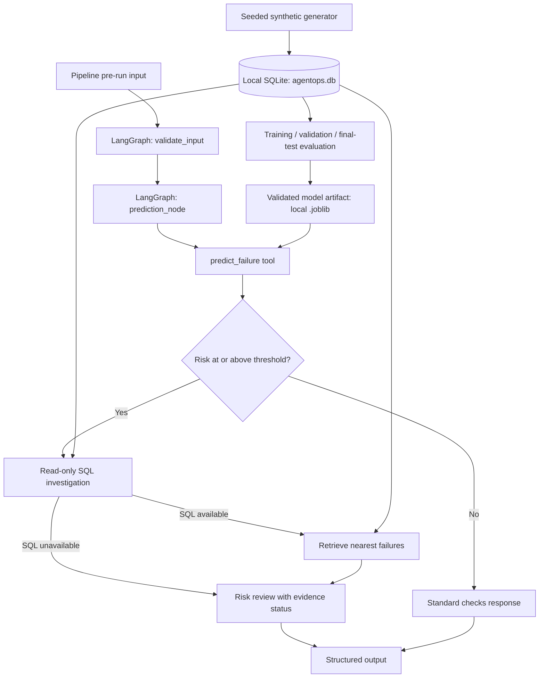
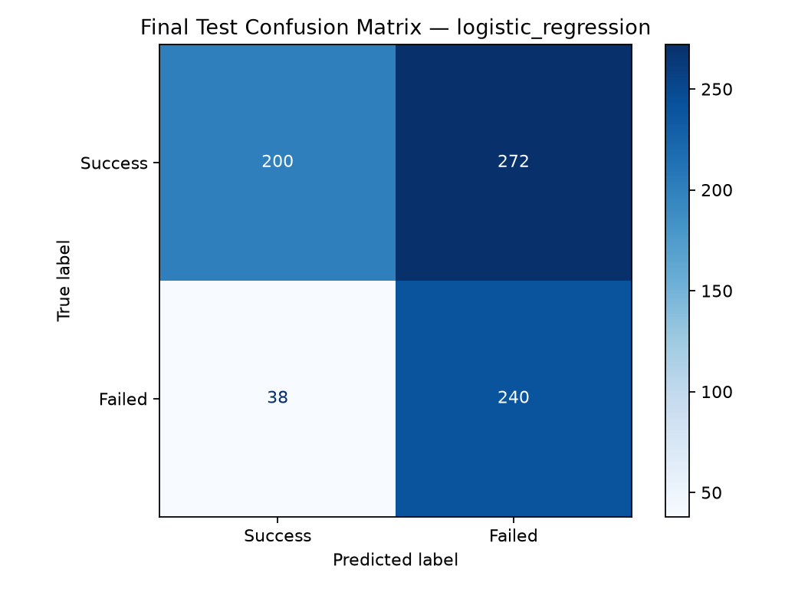
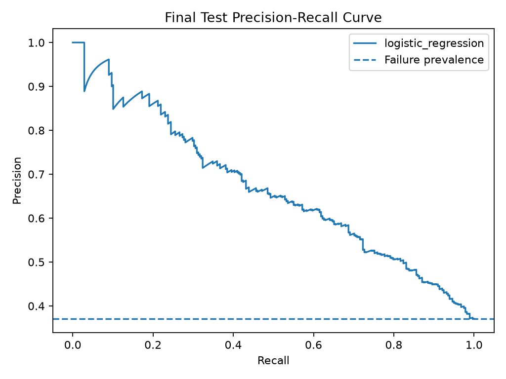
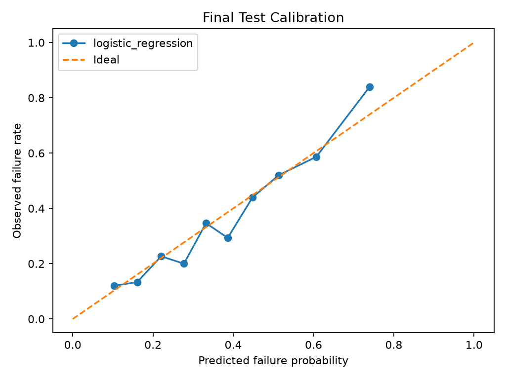

# AgentOps Intelligence Lab

**A reproducible, evaluation-first prototype for predicting data-pipeline failures and building toward evidence-grounded AI incident investigation.**

**Current status:** Synthetic data pipeline, baseline predictive ML, validated evaluation workflow, inference tool, read-only SQL evidence retrieval, similar incident retrieval, and deterministic LangGraph risk routing implemented. The workflow reports incomplete investigations when evidence tools fail. Optional local JSON traces record node execution, timing, evidence status, and failures. Thirty-seven regression tests cover inference contracts, evidence retrieval, risk routing, tool failures, and tracing. **Planned:** semantic incident retrieval/RAG, LLM-assisted investigation, broader agent evaluations, OpenTelemetry, API deployment, containerization, and deployment automation.

> **Scope and safety:** This is a portfolio/research prototype using synthetic data. Its risk probabilities and recommendations are **not validated for production decisions**. It does not currently take autonomous remediation actions.

## Interactive BI dashboard

[Dashboard source](docs/dashboard/index.html) — a browser-based view of 5,000 reproducible synthetic incidents. Filter by pipeline, outcome, date, or root cause; click chart categories to cross-filter; inspect individual runs and export the current selection as CSV. All calculations happen locally in the browser. No database, API key, production data, or model artifact is required. This is instant analysis of a fixed synthetic sample, not live monitoring or model inference.

To try locally, open `docs/dashboard/index.html` in a browser or run `python -m http.server 8000 --bind 127.0.0.1 --directory docs` and visit `http://localhost:8000/dashboard/`. Regenerate the sample with `python docs/dashboard/export_sample.py` and check calculations with `node --test docs/dashboard/dashboard.test.js`.

## 1. Mission and problem

Production data platforms run ingestion, ETL, synchronization, and reporting jobs. Failures may stem from resource pressure, workload, or transient processing issues. Teams need not only alerts but also reproducible risk estimates, relevant evidence, and explanations that can be tested.

**Mission:** Build an end-to-end system that evolves from **data generation → failure-risk prediction → tool-based investigation → stateful agent orchestration → rigorous evaluations → observable deployment**.

**Questions this project explores:**
- Can pre-execution signals estimate failure risk without leaking information from after a run?
- How should a prediction service be wrapped as a safe, reusable tool?
- How can a graph direct high-risk cases to further review while preserving traceable state?
- How do we evaluate predictive models *and* agent behavior separately?

## 2. What is implemented today

| Layer | Implementation | Status |
|---|---|---|
| Data | Reproducible Python generators and local SQLite tables | Implemented |
| Synthetic scenarios | 5,000 `realistic_incidents` rows with simulated pre-run conditions and simplified root-cause labels | Implemented |
| Predictive ML | Majority-class baseline, Logistic Regression, Random Forest | Implemented |
| Evaluation | Chronological 70/15/15 split; select model on validation average precision; tune threshold on validation F1; final test metrics and figures | Implemented |
| Inference | `predict_failure()` validates inputs, loads the local trusted model artifact, returns structured risk output | Implemented |
| Workflow | LangGraph shared state, validation and prediction nodes, conditional high/low-risk routes | Implemented (deterministic) |
| SQL investigation | Read-only, parameterized SQLite queries; time cutoff; failure counts and recorded labels | Implemented |
| Similar incident retrieval | Fixed-scale feature distance; prior failures; traceable run IDs | Implemented |
| Workflow reliability | Explicit investigation status; structured storage errors; preserve available evidence | Implemented |
| Local run tracing | Per-run JSON records with node durations, routes, evidence status and error types | Implemented (local only) |
| Regression tests | SQL filtering, time cutoff, empty results, risk routing, and incomplete evidence | Implemented |
| Agent reasoning, RAG, external telemetry, deployment | Not yet implemented | Roadmap |

**Terminology:** The current LangGraph system is a deterministic tool-using workflow, **not** an autonomous LLM agent. The elevated-risk branch now retrieves SQL evidence before risk review. Semantic retrieval/RAG, LLM-driven decisions, and guarded remediation are future milestones.

## 3. Architecture



In the workflow, **state** carries the input, prediction, SQL evidence, retrieved incidents and route; **nodes** do bounded work; **edges** define execution order; the **conditional edge** selects a route. The ML model performs inference—it does not orchestrate the graph.

For the current graph definition, see [the LangGraph workflow diagram](docs/langgraph_workflow.md). For architecture and evaluation decisions, see [architecture](docs/architecture.md), [evaluation methodology](docs/evaluation_methodology.md), and the [model card](docs/model_card.md).

## 4. Data design

Two original tables (`pipeline_runs`, `prediction_features`) were used to practice ingestion, schema design, SQL joins, and label validation. A separate `realistic_incidents` table supports later ML work.

The synthetic incident generator uses a fixed seed and a specified probability function so outcomes are reproducible and have a relationship to **pre-run features**:

| Pre-run feature | Description |
|---|---|
| `expected_workload` | Anticipated number of records or workload units |
| `cpu_usage_pct` | Simulated CPU utilization |
| `memory_usage_pct` | Simulated memory utilization |
| `recent_failure_rate` | Simulated historical failure-rate signal |

**Labels / post-run evidence:** `target_failed` indicates the simulated observed outcome, while `root_cause` is a simplified assigned incident label. Neither is used as a model input. Realistic incident ground truth and temporal dependencies remain areas for improvement.

**Previously observed synthetic dataset:** 5,000 rows; 1,886 failed runs (37.72%). Root-cause categories included transient processing error, memory pressure, CPU saturation, and high workload. These are synthetic counts, not operational benchmarks.

## 5. ML training and evaluation

We compare a majority-class baseline, Logistic Regression, and Random Forest. In the improved evaluation harness, data is sorted by `started_at`, then split chronologically:

- Training: 3,500 rows (70%)
- Validation: 750 rows (15%) — model selection and threshold tuning
- Final test: 750 rows (15%) — evaluation of the frozen selection

Logistic Regression was selected by **validation average precision**; the decision threshold **0.26** was chosen using validation F1. The final reported metrics from the synthetic held-out test set were:

| Metric | Value |
|---|---:|
| Precision (failure class) | 0.4688 |
| Recall (failure class) | 0.8633 |
| F1 (failure class) | 0.6076 |
| Average precision | 0.6688 |
| ROC-AUC | 0.7537 |
| Brier score | 0.1890 |

**Interpretation:** A threshold tuned for greater failure recall catches many simulated failures but produces false alerts. Neither these numbers nor the threshold should be taken as production performance guarantees. Because failure labels were generated using a logistic probability function, Logistic Regression has a favorable inductive bias in this experiment.

### Evaluation figures







See [model card](docs/model_card.md) for assumptions, intended use, and limitations.

## 6. Project structure

```text
agentops-intelligence-lab/
├── assets/                            # Evaluation charts
├── data/                              # Local SQLite data (not committed)
├── docs/                              # Architecture, methodology, model card, graph diagram
├── evals/
│   └── evaluate_model.py              # Validation-based model selection and final evaluation
├── models/                            # Local model artifacts (not committed)
├── src/
│   ├── ingestion/
│   │   ├── generate_dataset.py
│   │   ├── generate_prediction_features.py
│   │   └── generate_realistic_incidents.py
│   ├── prediction/
│   │   └── Train_model.py              # Initial ML baseline experiment
│   ├── tools/
│   │   ├── prediction_tool.py          # Validated inference interface
│   │   ├── sql_investigation_tool.py   # Read-only incident evidence
│   │   └── incident_retrieval_tool.py   # Similar failed runs and source IDs
│   ├── observability/
│   │   ├── tracing.py                 # Local per-run node instrumentation
│   │   └── run_workflow.py            # Traced runner and high/low-risk examples
│   └── agents/
│       └── graph.py                    # Current deterministic LangGraph workflow
├── tests/
│   ├── test_prediction_tool.py         # Input, artifact, probability and routing contract
│   ├── test_investigation.py           # SQL and workflow regression checks
│   ├── test_incident_retrieval.py       # Ranking, filtering, and shared cutoff
│   ├── test_workflow_reliability.py     # Missing sources, partial evidence, error boundaries
│   └── test_run_tracing.py             # Paths, timings, failed nodes, isolation and CLI
├── requirements.txt
└── README.md
```

## 7. Reproduce locally

**Prerequisites:** Python 3.12 (the project was developed using Python 3.12) and a shell. SQLite is accessed through Python's standard-library `sqlite3`; SQLiteStudio is not required.

```bash
# Clone the project
 git clone https://github.com/AimanManzoor/agentops-intelligence-lab.git
 cd agentops-intelligence-lab

# Isolated environment
 python3 -m venv .venv
 source .venv/bin/activate
 python -m pip install -r requirements.txt
 mkdir -p data

# Recreate local synthetic incidents and train/validate the model
 python src/ingestion/generate_realistic_incidents.py
 python evals/evaluate_model.py

# Run inference and the graph
 python src/tools/prediction_tool.py
 python src/agents/graph.py
```

**Current fresh-clone setup caveat:** `generate_realistic_incidents.py` uses the project's `data/agentops.db` path. If `data/` is absent in a fresh clone, create it first with `mkdir -p data`. The `data/` folder and `.db` files are intentionally ignored by Git. The `.joblib` model must be generated locally by the evaluation script before inference or graph execution.

**Do not load untrusted `.joblib` files:** Python pickle/joblib deserialization can execute code. Only use artifacts produced by code and environments you trust.

### SQL evidence and regression checks

Run the standalone evidence tool:

```bash
python src/tools/sql_investigation_tool.py
```

Run the regression tests:

```bash
python -m unittest discover -s tests -v
```

The elevated-risk path is **prediction → investigate → retrieve_incidents → risk_review**; the lower-risk path skips SQL. The investigation tool opens SQLite in read-only mode and uses parameterized queries. It returns the source table, synthetic-data marker, UTC cutoff, total runs, failed runs, historical failure rate, and recorded failure labels.

An optional graph input, `as_of_utc`, sets the evidence cutoff; otherwise the tool uses the current UTC time. Only records whose `started_at` is strictly before that cutoff are included. Naive timestamps are interpreted as UTC. The synthetic schema does not include completion timestamps, so this filter is based on run start time.

A pipeline with no matching history returns zero counts, a null historical failure rate, and an empty label list. This is a successful query with no matching records, not a source failure.

The graph handles `FileNotFoundError` and SQLite errors from the two evidence tools. If SQL fails, it skips similar-incident retrieval and returns `investigation_status="unavailable"` with null evidence and retrieval. If only similar-incident retrieval fails, it preserves the SQL summary and returns `investigation_status="partial"`. Successful high-risk investigations return `complete`; lower-risk cases return `not_requested` and skip both tools. Structured `tool_errors` identify the tool and exception type. Model errors, input-validation errors, and unexpected programming errors still propagate; there is no automatic repair or retry.

See [workflow reliability](docs/workflow_reliability.md) for response examples, failure tests, research interpretation, and limitations.

The historical failure rate is an observed fraction across the selected pipeline's recorded runs, not a replacement for the model's case-specific risk estimate. Recorded synthetic labels supply context and do not establish the cause of a new case.

The regression suite uses a temporary SQLite database and controlled prediction outputs. They check workflow and SQL behavior rather than predictive accuracy, and do not require a trained model artifact. The separate local smoke checks exercised the trained model's elevated-risk and lower-risk examples.

See [similar incident retrieval](docs/incident_retrieval.md) for ranking, source references, and limitations.

### Local run traces

With the local model artifact and database already generated, run both examples:

```bash
python -m src.observability.run_workflow --example both
```

Each invocation saves `runs/<run_id>.json` and prints its path, node order, elapsed time,
route, and investigation status. `runs/` is ignored by Git. The trace distinguishes
completed execution with incomplete evidence from an unhandled workflow failure.
It records node names, durations, statuses and error types without recording input
features, database rows, final messages or raw exception messages. The synchronous
runner saves a trace before re-raising ordinary workflow exceptions when trace storage
is available. The existing untraced graph remains available through `build_graph()`.

This is local instrumentation, not an OpenTelemetry deployment or a production
latency benchmark. See [local run tracing](docs/run_tracing.md) for the schema,
Python interface, timing definitions, tests, and limits.

## 8. Learning goals and engineering decisions

| Concept | Where it appears | Why it matters |
|---|---|---|
| Data ingestion | `src/ingestion/` | Repeatable upstream inputs |
| Reproducibility | Fixed random seed and `requirements.txt` | Repeatable development runs |
| Leakage prevention | Pre-run features only | Avoid misleading predictions |
| Honest evaluation | Validation/test separation | Avoid selection bias |
| Inference boundary | `prediction_tool.py` | Reusable, validated tool contract |
| Stateful orchestration | LangGraph `AgentState` | Predictable data flow between nodes |
| Conditional routing | `route_by_risk()` | Clear risk-dependent workflow |
| Version control | Git commits and public repository | Traceable milestones |

**What this project demonstrates today:** the ability to connect data generation, validation, ML evaluation, model inference, conditional graph routing, SQL evidence, and similar incident retrieval. **What comes next:** semantic incident retrieval/RAG and evaluated LLM-assisted investigation.

## Prediction reliability milestone

The inference tool now validates inputs before accessing a model artifact,
checks artifact metadata and threshold bounds, locates the failure class by label,
and rejects invalid probability shapes, NaN/infinite values, out-of-range values,
or probability rows that do not sum to one within tolerance.

Prediction failures stop the graph before either evidence tool runs. There is no
fallback lower-risk prediction, retry, artifact repair, or model retraining.
Routing uses the unrounded probability; the display rounds to four decimals.

Twelve new tests bring the suite to **37**. They include a small locally trained
artifact roundtrip and a graph-level invalid-probability failure. The new regression
cases expose failures against the previous implementation; all 37 tests pass
locally with the fix. Dependency compatibility also passed. Hosted Actions results
must be checked separately after the push.

See [prediction contract](docs/prediction_contract.md),
[model card](docs/model_card.md), and
[evaluation methodology](docs/evaluation_methodology.md).
The model card records the previously reported synthetic results; this milestone
does not rerun the full-dataset evaluation or claim improved predictive quality.

### Baseline v1 finish line

The following would make a bounded, reviewable baseline release:

1. Completed: versioned workflow scenario evaluation with expected routes, tool
   calls, evidence cutoffs, incomplete-source outcomes, and trace outcomes.
2. Verify the documented fresh-clone data generation, training, inference, and
   traced high/low-risk examples in one clean environment; record actual results.
3. Review the results and limitations together and publish a baseline release.

RAG, LLM-assisted investigation, OpenTelemetry, a UI/API and containerized hosting
are optional later milestones rather than prerequisites for this deterministic
baseline. If adding an LLM, first define reference tasks, permitted actions and
independent evidence checks; compare it against the deterministic workflow.

## 9. Roadmap

- [x] Seeded synthetic pipeline data and SQLite storage
- [x] Baseline model training and visual evaluation
- [x] Train/validation/test evaluation and threshold tuning
- [x] Validated inference tool
- [x] Deterministic LangGraph graph and conditional routing
- [x] Regression tests for SQL evidence retrieval and both graph branches
- [x] Automated tests for inference input validation, trusted-artifact contracts, class ordering, and probability outputs
- [x] Read-only SQL investigation tool and incident evidence retrieval
- [x] Structured incident retrieval with source IDs
- [x] Explicit incomplete-investigation responses and tool-failure regression tests
- [x] Local node-level run traces and traced high/low-risk runner
- [ ] Historical search / RAG and context selection with source attribution
- [ ] LLM-based investigation and tool-choice policies with safeguards
- [x] Versioned deterministic workflow evaluation: routing, tool calls, cutoffs, evidence outcomes, and traces
- [ ] Broader agent evaluation: semantic groundedness, model quality, and performance under realistic load
- [ ] OpenTelemetry traces, real telemetry ingestion and drift checks
- [x] GitHub Actions regression workflow
- [ ] FastAPI, Docker, deployment automation and monitoring

## 10. Current limitations

1. The incident dataset is synthetic; results are not generalizable without real-world evaluation.
2. The `recent_failure_rate` is simulated, not derived from real historical windows.
3. Root-cause labels are rule-assigned and are not independently verified causal explanations.
4. There is no live source ingestion, semantic incident retrieval/RAG, LLM reasoning, human approval workflow, or deployed service yet.
5. The local SQLite database and model binaries are intentionally excluded from the repository.

---

**Portfolio focus:** practical AI engineering fundamentals—data quality, explicit tool contracts, reproducible evaluations, explainable stateful workflows, and incremental deployment readiness.


## Automated regression checks

Workflow: `.github/workflows/tests.yml`.

On pushes to main, pull requests, or manual runs, GitHub starts an Ubuntu
job using Python 3.12. It installs requirements.txt, checks dependency
compatibility, runs the regression suite, and evaluates the versioned workflow scenarios.

The job fails if no tests are discovered, any test fails, or any workflow scenario fails.
No API keys, local database, or trained model artifact are required.
Tests use controlled prediction outputs and temporary fixtures.

Run locally in the project environment:

    python -m pip check
    python -m unittest discover -s tests -v
    python -m evals.evaluate_workflow

The current suite contains 44 regression tests and 8 workflow scenarios. A clean-environment local run passed
before preparing this workflow. Check the first hosted run after pushing:

https://github.com/AimanManzoor/agentops-intelligence-lab/actions

Select AgentOps regression tests and inspect any failed step.

A passing workflow checks covered software behavior. It does not establish
predictive accuracy, groundedness, or production reliability.
This job does not train models or deploy a service.

Making this check mandatory before merging requires a separate repository
ruleset or branch-protection configuration.

## Versioned workflow evaluation milestone

Run `python -m evals.evaluate_workflow` from the repository root. The runner
loads eight manually specified contracts from `evals/workflow_scenarios_v1.json`,
executes the traced graph against a fresh temporary SQLite fixture per case,
and prints a JSON report with per-check failures and a reference SHA-256.
Exit codes: 0 = all cases pass, 1 = contract mismatch, 2 = invalid reference.

Covered cases: high risk with prior evidence, low risk with no evidence calls,
empty history, missing database, missing table, retrieval failure, prediction
failure, and invalid request. Checks cover node order, tool-call counts, shared
cutoffs, SQL counts, source IDs, selected message facts, trace outcomes,
payload omission, and unchanged fixture databases. Exact-cutoff and future
records are decoys and must not appear in the healthy case.

Local validation: **44 regression tests and all 8 scenarios passed**. Negative
controls detected wrong reference counts, broken routing, future evidence,
and a payload injected into a trace. CLI tests verified nonzero failure exits.
Hosted Actions status is a separate result: inspect the workflow after pushing.

Predictions are controlled stubs. SQL evidence and incident retrieval use the
real implementations, except an explicitly injected retrieval storage error.
No API keys, local project database, trained project model, or provider calls
are required. This is a deterministic contract regression suite, not a held-out
model benchmark, a production reliability estimate, or a semantic groundedness
score. Timing fields are not graded as performance targets.

See [workflow evaluation methodology](docs/workflow_evaluation.md).


## Reproduction evidence

[Local reproduction check](docs/reproduction_check.md)


## Dashboard export security

CSV formula-risk handling, six security regression tests and CI coverage.
See [security scope and limitations](docs/security.md).

Run locally: `node --test docs/dashboard/*.test.js`.


## Cost-aware alert policy experiment

Compare validation-selected alert thresholds under versioned illustrative costs
and investigation-capacity limits. Report precision, recall, false alerts, missed
failures and alert volume against the existing 0.26 threshold and constant policies.
This is a retrospective synthetic experiment; it does not deploy a threshold.

Run: `python -m evals.evaluate_alert_policy`.
See [protocol and interpretation](docs/alert_policy.md).
