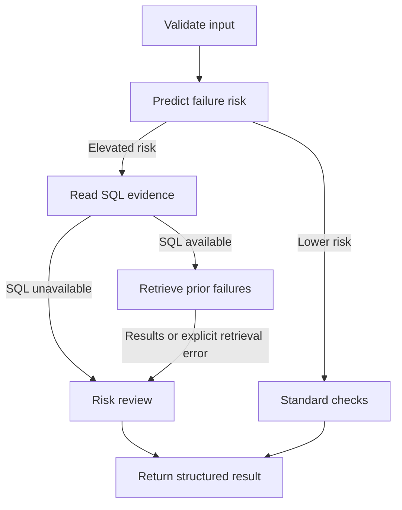

# AgentOps LangGraph Workflow

Successful investigations return `complete`, including those with no matching
history. SQL storage failures return `unavailable` and skip retrieval. Retrieval
storage failures return `partial` while preserving SQL evidence. Lower-risk runs
return `not_requested` and skip both tools. Input/model errors and unexpected
programming errors still propagate.

See [workflow reliability](workflow_reliability.md) for the response contract and tests.

